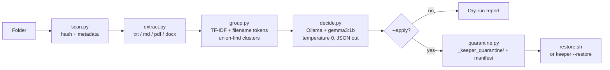

# Keeper

**Your folder has a `contract.pdf`, `contract_final.pdf`, `contract_final_v2(1).pdf`, and `contract_FINAL (copy).pdf`. Which one is the real one?**

Keeper answers that. It scans a folder full of version-clone files, groups them by *actual content* (not filename), asks a local open-weight model which copy is the keeper and **why**, and quarantines the rest. Dry-run by default. It never deletes a thing.

```
keeper ~/Downloads            # scan + verdicts, moves nothing
keeper ~/Downloads --apply    # quarantine the losers
keeper ~/Downloads --restore  # put everything back, byte-for-byte
```

## Why this exists

Duplicate finders tell you files are identical. Diff tools make you pick the two files to compare by hand. Neither one answers the question you actually have: **"I have five versions of the same document — which one do I keep?"**

Keeper walks the folder itself, clusters the versions, and gives you a verdict with a one-line reason attached:

```
[1] 3 copies of the same thing  (decided by model)
    KEEP   rental_agreement_final_v2(1).txt
    WHY    This is the newest version and includes both signed lines.
    loser  rental_agreement.txt
    loser  rental_agreement_final.txt
```

## How it works



1. **Scan** — walks the folder (skipping `.git`, `node_modules`, its own quarantine), records size, mtime, and sha256.
2. **Extract** — pulls text from `.txt`, `.md`, `.csv`, `.pdf` (pypdf), `.docx` (python-docx). A scanned PDF with no text layer is honestly flagged instead of treated as empty.
3. **Group** — byte-identical files cluster by hash; near-duplicates cluster by filename-token overlap (`rental_agreement_final_v2(1)` ≈ `rental_agreement`) and TF-IDF cosine over extracted content. Pure Python, no ML dependency.
4. **Decide** — one call per cluster to a **local Ollama model** (`gemma3:1b` by default, `--model gemma3:4b` to upgrade), temperature 0, forced JSON: `{keep, reason, confidence}`. If Ollama is down or the answer is unusable, a transparent rule fallback takes over: readable beats unreadable, newest wins, bigger wins.
5. **Quarantine** — `--apply` moves losers into `_keeper_quarantine/<group>/` with a `manifest.json` and a portable `restore.sh`. `--restore` puts every file back where it came from.

## Safety model

- **Dry-run by default.** Nothing moves without `--apply`.
- **Never deletes.** Losers are moved, not removed. Every byte is accounted for in the manifest.
- **Fully reversible.** `keeper <folder> --restore` returns the folder to its exact prior state (verified by tests that compare byte-for-byte snapshots).
- **Nothing leaves your machine.** The model runs locally via Ollama. No API keys, no telemetry, no network calls beyond `localhost:11434`.

## Install

Requires Python 3.11+ and [Ollama](https://ollama.com) with an open-weight model:

```bash
ollama pull gemma3:1b     # ~800 MB, runs on 4 GB RAM

git clone https://github.com/atif-1402/keeper
cd keeper
uv sync                    # or: pip install -e .
uv run keeper ~/Downloads  # dry run
```

No Ollama? Keeper still works — it falls back to the rule engine and tells you so:

```
Ollama is not running — falling back to the rule engine for all groups.
```

## CLI

| Command | What it does |
|---|---|
| `keeper <folder>` | Scan, cluster, decide, print report. Moves nothing. |
| `keeper <folder> --apply` | Move losing copies into `_keeper_quarantine/` |
| `keeper <folder> --restore` | Undo `--apply`, byte-for-byte |
| `keeper <folder> --model gemma3:4b` | Use a different (bigger) open-weight model |
| `keeper <folder> --no-model` | Skip the model, rule engine only |
| `keeper <folder> --report out.md` | Also write a Markdown report |

## Why open innovation matters here

The files Keeper reads are contracts, passports, medical letters, tax returns. Sending filenames and text excerpts to a closed cloud model is exactly the wrong default. `gemma3:1b` runs on your laptop, reads your lease agreement, and forgets it when the process exits. The tool's entire reasoning pipeline — grouping, prompting, fallback — is in this repo, auditable in an afternoon. That's what an open-weight model buys you: a private assistant with no exfiltration surface and no vendor who can change the terms next quarter.

## Development

```bash
uv sync
uv run pytest -q
```

Tests cover extraction (including the no-text-layer flag), clustering, decision fallbacks, the quarantine round-trip, and CLI behaviour.

## License

MIT — see [LICENSE](LICENSE).
# keeper
