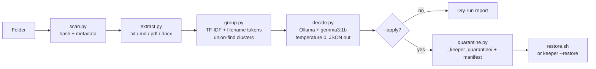

<p align="center">
  
</p>

<p align="center">
  Finds version-clone files in any folder, asks a local open-weight model which copy to keep, and quarantines the rest — dry-run by default, 100% offline.
</p>

<p align="center">
  <a href="https://github.com/atif-1402/keeper/blob/main/LICENSE"></a>
  <a href="https://www.python.org/downloads/"></a>
  <a href="https://ollama.com/"></a>
  
  <a href="https://ko-fi.com/anom538"></a>
</p>

<p align="center">
  <a href="#install">Install</a> ·
  <a href="#how-it-works">How it works</a> ·
  <a href="#safety-model">Safety model</a> ·
  <a href="#cli">CLI</a> ·
  <a href="#why-open-innovation-matters-here">Why open weights</a>
</p>

## Why this exists

Duplicate finders tell you files are identical. Diff tools make you pick the two files to compare by hand. Neither one answers the question you actually have: **"I have five versions of the same document — which one do I keep?"**

Keeper walks the folder itself, clusters the versions, and gives you a colored verdict table with a one-line reason per cluster. While it works you get a live spinner — one line that updates itself (`hashing files` → `extracting text` → `asking gemma3:1b — index.html [3/9] · about 40s left`) instead of a wall of progress output. Column widths follow your terminal and every cell wraps — nothing is ever cut off:

```
┌───┬────────┬──────────────────────────────────────┬─────────────┬────────────────────────────────┬─────────────────────────┐
│ # │ Copies │ KEEP                                 │ Decided     │ Why                            │ Losers                  │
╞═══╪════════╪══════════════════════════════════════╪═════════════╪════════════════════════════════╪═════════════════════════╡
│ 1 │      3 │ rental_agreement_final_v2(1).txt     │ ● model     │ The agreement is finalized and │ rental_agreement.txt    │
│   │        │                                      │             │ includes a cat allowance.      │ rental_agreement_… +1   │
├───┼────────┼──────────────────────────────────────┼─────────────┼────────────────────────────────┼─────────────────────────┤
│ 4 │      2 │ passport_scan2.pdf                   │ ◆ identical │ all copies are byte-identical; │ passport_scan.pdf       │
│   │        │                                      │             │ kept the newest timestamp      │                         │
└───┴────────┴──────────────────────────────────────┴─────────────┴────────────────────────────────┴─────────────────────────┘
```

## How it works



1. **Scan** — walks the folder (skipping `.git`, `node_modules`, its own quarantine), records size, mtime, and sha256.
2. **Extract** — pulls text from `.txt`, `.md`, `.csv`, `.pdf` (pypdf), `.docx` (python-docx). A scanned PDF with no text layer is honestly flagged instead of treated as empty. Images, video, audio, archives and fonts are recognized as media up front — their bytes are never decoded into garbage "text".
3. **Group** — byte-identical files cluster by hash; near-duplicates cluster by filename-token overlap (`rental_agreement_final_v2(1)` ≈ `rental_agreement`, browser `(2)` collision suffixes stripped) and TF-IDF cosine over extracted content. Names carrying *different* identity numbers (`S07E02` vs `S07E04`, `Lesson13` vs `Lesson14`) are never merged — TV episodes and numbered lessons stay apart. Pure Python, no ML dependency.
4. **Decide** — only clusters with readable text get a model call; byte-identical clusters and unreadable ones (zips, images, videos) are settled instantly from metadata, so a low-end machine runs Gemma only when it actually matters. Each call goes to a **local Ollama model** (`gemma3:1b` by default, `--model gemma3:4b` to upgrade), temperature 0, capped output, forced JSON: `{keep, reason, confidence}`. If Ollama is down or the answer is unusable, a transparent rule fallback takes over: readable beats unreadable, newest wins, bigger wins — and a model verdict that contradicts hard evidence (signed/newest) is overruled, not trusted.
5. **Quarantine** — `--apply` moves losers into `_keeper_quarantine/<group>/` with a `manifest.json` and a portable `restore.sh`. `--restore` puts every file back where it came from.

## Safety model

- **Dry-run by default.** Nothing moves without `--apply`.
- **Never deletes.** Losers are moved, not removed. Every byte is accounted for in the manifest.
- **Fully reversible.** `keeper <folder> --restore` returns the folder to its exact prior state (verified by tests that compare byte-for-byte snapshots).
- **Nothing leaves your machine.** The model runs locally via Ollama. No API keys, no telemetry, no network calls beyond `localhost:11434`.

## Install

### Linux / macOS — one-liner

```bash
curl -fsSL https://raw.githubusercontent.com/atif-1402/keeper/main/install.sh | bash
```

Downloads the standalone binary for your platform (x86_64 or aarch64, no Python needed) into `~/.local/bin`. No sudo. Re-run it anytime to update.

### Windows

Keeper is pure Python, so it runs on Windows today:

```powershell
pipx install git+https://github.com/atif-1402/keeper   # or:
python -m pip install "git+https://github.com/atif-1402/keeper"
```

(Prebuilt `.exe` builds ship with every tagged release — grab `keeper-windows-x86_64.exe` from the [releases page](https://github.com/atif-1402/keeper/releases) if you'd rather not touch Python.)

### Other methods

```bash
uv tool install "git+https://github.com/atif-1402/keeper"   # uv users
git clone https://github.com/atif-1402/keeper && cd keeper
uv sync && uv run keeper ~/Downloads                        # from source
```

### The model

Keeper's AI verdicts run on a local [Ollama](https://ollama.com) model — nothing leaves your machine:

```bash
ollama pull gemma3:1b     # ~800 MB, runs on 4 GB RAM
```

No Ollama? Keeper still works — it falls back to the rule engine and tells you so:

```
Ollama is not running — falling back to the rule engine.
```

## CLI

| Command | What it does |
|---|---|
| `keeper <folder>` | Scan, cluster, decide, print report. Moves nothing. Uses the model when Ollama is up, rules otherwise. |
| `keeper <folder> --apply` | Move losing copies into `_keeper_quarantine/` |
| `keeper <folder> --restore` | Undo `--apply`, byte-for-byte |
| `keeper <folder> --model gemma3:4b` | Use a different (bigger) open-weight model |
| `keeper <folder> --no-model` | Rule engine only — never call a model |
| `keeper <folder> --model-only` | Model required — error out if Ollama is down instead of falling back |
| `keeper <folder> --no-eta` | Hide the elapsed/remaining time in the spinner |
| `keeper <folder> --report out.md` | Also write a Markdown report |

While it works, the spinner shows a live clock and — once it has measured your machine's speed — a countdown: `asking gemma3:1b — index.html [3/9] · about 40s left`. A slow box honestly shows minutes; a fast one shows seconds. No fixed timings, just measured throughput.

## Why open innovation matters here

The files Keeper reads are contracts, passports, medical letters, tax returns. Sending filenames and text excerpts to a closed cloud model is exactly the wrong default. `gemma3:1b` runs on your laptop, reads your lease agreement, and forgets it when the process exits. The tool's entire reasoning pipeline — grouping, prompting, fallback — is in this repo, auditable in an afternoon. That's what an open-weight model buys you: a private assistant with no exfiltration surface and no vendor who can change the terms next quarter.

## Development

```bash
uv sync
uv run pytest -q
```

Tests cover extraction (including the no-text-layer flag), clustering, decision fallbacks, the quarantine round-trip, and CLI behaviour.

## License

MIT — see [LICENSE](LICENSE).
